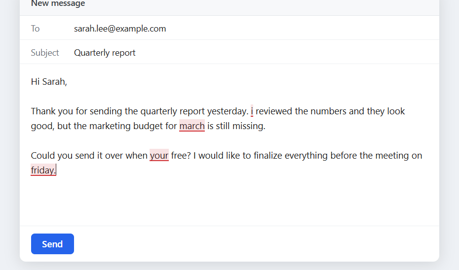
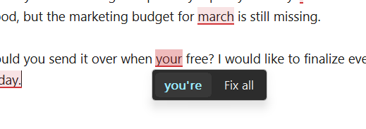
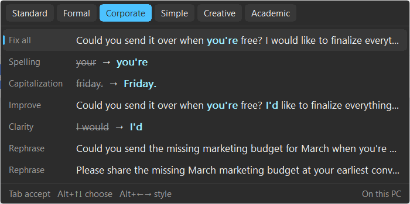

# Margin

A system-wide writing assistant for Windows. Margin works in the app you are typing in (browsers, chat apps, email, desktop apps) and suggests fixes and rewrites on the text itself. There is no separate window to paste into.



## Download

Get `Margin-<version>-windows-x64.zip` from the [latest release](../../releases/latest), unzip it and run `Margin.exe`. There is nothing to install.

- On first run Margin downloads its writing model in the background: about 2.4 GB on PCs with a 6 GB+ graphics card, 1.1 GB otherwise. Grammar underlines work right away.
- Windows may show "Windows protected your PC" because the app isn't code-signed. Choose **More info → Run anyway**.
- Margin lives in the notification area (the blue **M**). Right-click it for Settings, Pause and Quit.

## What it does

- **Correct**: fixes spelling, grammar, capitalization and punctuation in every paragraph of the text box, while keeping your wording and casual tone.
- **Improve**: makes the writing clearer and smoother without making a casual message formal.
- **Rephrase**: gives two other ways to say the same thing, in six styles: Standard, Formal, Corporate, Simple, Creative and Academic.
- **Next-word prediction**: shows grey text after the cursor. Press Tab to type it.

Mistakes get a solid underline and a light highlight on the word, in any paragraph. Hover one to get a small pill with the fix, then click it or press Tab. Only that word changes, and your cursor goes back to where you were typing.



**Ctrl+Shift+Space** opens the full list for the paragraph you're writing: every fix, an improved version and rephrasings. Pick a style with the buttons on top, or with Alt+←/→.



## How it works

| Layer | What |
|---|---|
| Text access | Windows UI Automation reads only the field you are typing in, never password fields. It works with Chromium browsers, Electron apps, and Win32 and RichEdit controls. |
| Rule checker | [Harper](https://github.com/Automattic/harper) runs offline in about 3 ms per paragraph. Its results show instantly and are passed to the model as hints. |
| Language model | Runs on your PC with [llama.cpp](https://github.com/ggml-org/llama.cpp). Qwen3-4B is used with a GPU that has at least 6 GB, Qwen2.5-1.5B otherwise. The runtime and model are downloaded on first use and checked against their SHA-256 hashes. |
| Validation | Each model suggestion is aligned word by word with your text and rejected if it changes the meaning. It must keep negations, names, numbers, slang and words from other languages. |
| Insertion | Suggestions are typed with `SendInput`, so the app's own undo (Ctrl+Z) works. |

See [ARCHITECTURE.md](ARCHITECTURE.md) for the design and trade-offs, and [bench/QUALITY.md](bench/QUALITY.md) for measured quality and latency.

## Privacy

- Text is processed on your PC by default. An optional custom server can be configured; the popup always shows where text goes.
- Margin never reads password fields and never saves what you type. It sends no telemetry.
- Apps or sites can be excluded in Settings.

## Build

Requirements: Windows 10/11, Rust (stable, MSVC toolchain).

```bash
cargo build --release
```

Run `target/release/margin.exe`. It lives in the notification area; settings are in the tray menu. On first run it downloads the model runtime and a writing model, about 1–2.5 GB.

If the project path is very long, the MSVC linker can fail with LNK1104. In that case, point the build directory somewhere short:

```bash
set CARGO_TARGET_DIR=C:\margin-target
```

## Tests

```bash
cargo test --release --lib
```

```bash
cargo run --release --example quality -- Qwen3-4B-Instruct-2507-Q4_K_M.gguf
```

```bash
cargo run --release --example e2e -- underline
```

- `cargo test` runs the unit tests: text, grammar, validation and inference parsing.
- `quality` runs the writing-quality suite in `tests/quality_cases.json`, for all modes.
- `e2e` runs the desktop end-to-end tests. They drive the real keyboard and mouse, so don't use the PC while they run. Other suites: `win32`, `edge`, `app`, `ghost`, `styles`, `latency`.

## Project layout

```
src/
  main.rs         app entry, message loop, timers, popup/underline coordination
  engine.rs       suggestion pipeline (reader + model threads, passes, caching)
  uia.rs          UI Automation: reading fields, caret and word positions, selection
  hook.rs         low-level keyboard hook (timing and shortcuts only)
  inject.rs       applying suggestions with SendInput
  grammar.rs      Harper rule checker tier
  inference.rs    model provider, per-mode instructions, styles
  validate.rs     meaning-preservation checks
  runtime.rs      llama.cpp download and supervision
  text.rs         composition, diffs, individual fixes, edit planning
  overlay.rs      underlines, highlights and grey prediction
  popup.rs        suggestion list and pill card
  settings_ui.rs  settings window
  tray.rs, theme.rs
examples/         quality suite, end-to-end harness, Harper probe
tests/            quality cases, test page
bench/            model benchmarks and results
```
